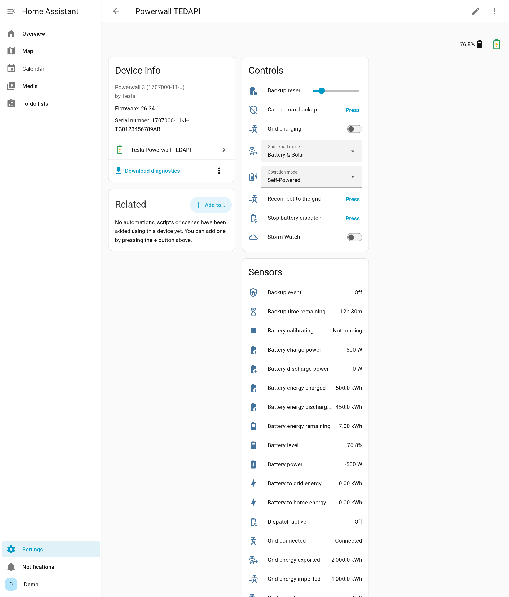

# Tesla Powerwall TEDAPI for Home Assistant

Local monitoring and control of a Tesla Powerwall from Home Assistant, through the gateway's own interface (TEDAPI). Built on [pypowerwall](https://github.com/jasonacox/pypowerwall). Works with the **Powerwall 3**, and with Powerwall 2 / Powerwall+ where the firmware supports it.

## What you get

- **Live readings every 30 seconds, without the cloud:** solar, battery, grid and home power, battery level, lifetime and daily energy for the Energy dashboard, battery health per pack, temperatures, fans, grid voltage and frequency, per-input solar on a Powerwall 3.
- **Control from your local network:** operation mode, backup reserve, grid charging and grid export.
- **Battery dispatch:** charge or discharge at a set power, or to a target level, for price-based automations.
- **Backup tools:** start a max backup, follow Storm Watch, test your backup by going off-grid with an automatic reconnect.
- **Dashboard buttons:** stop a battery dispatch, cancel a max backup or reconnect to the grid with one press.
- **Knows when something is wrong:** Tesla's alert codes in plain language, a **Problem** sensor, repairs, grid outage history and firmware update notices.
- **Keeps working when it can't reach the gateway:** an optional Tesla cloud backup (your Tesla account, or the Tesla Fleet / Teslemetry integration) keeps the settings usable.
- **A setup wizard:** it finds the Powerwall on your network and registers the access key for you. No command line.
- **Ready-made blueprints** for cheap charging, price spikes, negative feed-in, time-of-use and outage alerts.

> ⚠️ **Not affiliated with Tesla.** This uses undocumented interfaces that Tesla can change at any time. Battery dispatch overrides your export setting and may affect your warranty; going off-grid disconnects your house from the grid. Read [Safety](https://github.com/cnapagoda/ha-powerwall-tedapi/blob/main/docs/safety.md) before you use them.

## Quick start

1. **Install** through HACS: add this repository as a custom repository (type **Integration**), download **Tesla Powerwall TEDAPI**, and restart Home Assistant.

   

2. **Find the gateway password.** It's on the QR sticker inside the Powerwall's cover (Powerwall 3: behind the front glass, lower left).
3. **Add the integration:** **Settings → Devices & services → Add integration → Tesla Powerwall TEDAPI** (or **Add** under *Discovered*).

   

4. **Choose *Register a new key*,** sign in to Tesla once, then switch the Powerwall's **On/Off switch off for about 15 seconds and back on** within 10 minutes. The wizard notices the confirmation by itself.
5. **Add the energy sensors to the Energy dashboard** ([how](https://github.com/cnapagoda/ha-powerwall-tedapi/blob/main/docs/energy-dashboard.md)).

The full walkthrough, with screenshots and the other ways to connect, is in **[Quick start](https://github.com/cnapagoda/ha-powerwall-tedapi/blob/main/docs/quick-start.md)** and **[Setup](https://github.com/cnapagoda/ha-powerwall-tedapi/blob/main/docs/setup.md)**.

## Requirements

| | |
|---|---|
| Home Assistant | 2025.1 or newer (2026.3 or newer shows the integration's icon). |
| Powerwall | Powerwall 3 is tested. Powerwall 2 / Powerwall+ work for signed access if the firmware supports it, and over Wi-Fi with the gateway password. See [Compatibility](https://github.com/cnapagoda/ha-powerwall-tedapi/blob/main/docs/compatibility.md). |
| Network | Home Assistant reaches the gateway on your home network (recommended), or on the Powerwall's own Wi-Fi `192.168.91.1`. |
| Tesla account | Needed once, to register the access key. Optional afterwards, as the cloud backup. |
| Languages | English, German, French, Dutch, Spanish, Italian, Polish, Brazilian Portuguese. |

## Documentation

| Getting started | Using it | Reference | Help |
|---|---|---|---|
| [Quick start](https://github.com/cnapagoda/ha-powerwall-tedapi/blob/main/docs/quick-start.md) | [Energy dashboard](https://github.com/cnapagoda/ha-powerwall-tedapi/blob/main/docs/energy-dashboard.md) | [Entities](https://github.com/cnapagoda/ha-powerwall-tedapi/blob/main/docs/entities.md) | [Troubleshooting](https://github.com/cnapagoda/ha-powerwall-tedapi/blob/main/docs/troubleshooting.md) |
| [Setup in detail](https://github.com/cnapagoda/ha-powerwall-tedapi/blob/main/docs/setup.md) | [Dashboards](https://github.com/cnapagoda/ha-powerwall-tedapi/blob/main/docs/dashboards.md) | [Actions](https://github.com/cnapagoda/ha-powerwall-tedapi/blob/main/docs/actions.md) | [FAQ](https://github.com/cnapagoda/ha-powerwall-tedapi/blob/main/docs/faq.md) |
| [Configuration](https://github.com/cnapagoda/ha-powerwall-tedapi/blob/main/docs/configuration.md) | [Automations & blueprints](https://github.com/cnapagoda/ha-powerwall-tedapi/blob/main/docs/automations.md) | [Events](https://github.com/cnapagoda/ha-powerwall-tedapi/blob/main/docs/events.md) | [Compatibility](https://github.com/cnapagoda/ha-powerwall-tedapi/blob/main/docs/compatibility.md) |
| [Migrating from another integration](https://github.com/cnapagoda/ha-powerwall-tedapi/blob/main/docs/migration.md) | [Alerts](https://github.com/cnapagoda/ha-powerwall-tedapi/blob/main/docs/alerts.md) | [Cloud backup](https://github.com/cnapagoda/ha-powerwall-tedapi/blob/main/docs/cloud-backup.md) | [Safety](https://github.com/cnapagoda/ha-powerwall-tedapi/blob/main/docs/safety.md) |
| | [Tesla tariff](https://github.com/cnapagoda/ha-powerwall-tedapi/blob/main/docs/tesla-tariff.md) | [Dropped settings](https://github.com/cnapagoda/ha-powerwall-tedapi/blob/main/docs/dropped-settings.md) | [How it works & limitations](https://github.com/cnapagoda/ha-powerwall-tedapi/blob/main/docs/how-it-works.md) |

## Which connection?

| | Signed (recommended) | Wi-Fi password |
|---|---|---|
| Readings | ✅ local | ✅ local |
| Change mode, reserve, grid charging, export | ✅ local (cloud backup if set up) | ☁️ only through a cloud backup |
| Battery dispatch, max backup, go off-grid | ✅ | ❌ |
| Reaches the Powerwall at | Its home-network address, or its Wi-Fi | Its Wi-Fi only (Home Assistant must join `TeslaPW_…`) |
| Needs | The gateway password and a key registered once (the wizard does it) | The gateway password |

## Getting help

- Check [Troubleshooting](https://github.com/cnapagoda/ha-powerwall-tedapi/blob/main/docs/troubleshooting.md) and the [FAQ](https://github.com/cnapagoda/ha-powerwall-tedapi/blob/main/docs/faq.md).
- Open an [issue](https://github.com/cnapagoda/ha-powerwall-tedapi/issues/new/choose) with the integration's diagnostics attached (**Settings → Devices & services → Tesla Powerwall TEDAPI → ⋮ → Download diagnostics**).
- Running it on a Powerwall 2, Powerwall+ or several Powerwalls? A [hardware report](https://github.com/cnapagoda/ha-powerwall-tedapi/issues/new?template=hardware_report.yml) helps everyone.
- Security issues: report them privately, see [SECURITY.md](https://github.com/cnapagoda/ha-powerwall-tedapi/blob/main/SECURITY.md).

## Credits

- [pypowerwall](https://github.com/jasonacox/pypowerwall) by Jason Cox and contributors: TEDAPI, v1r signing, dispatch and Tesla login.
- [Tesla-API](https://github.com/Matthew1471/Tesla-API) research by Matthew1471 into the gateway's battery dispatch fields.

## Contributing

See [CONTRIBUTING.md](https://github.com/cnapagoda/ha-powerwall-tedapi/blob/main/CONTRIBUTING.md) and the [Code of Conduct](https://github.com/cnapagoda/ha-powerwall-tedapi/blob/main/CODE_OF_CONDUCT.md). What changed in each version is in the [CHANGELOG](https://github.com/cnapagoda/ha-powerwall-tedapi/blob/main/CHANGELOG.md).

## License

MIT
