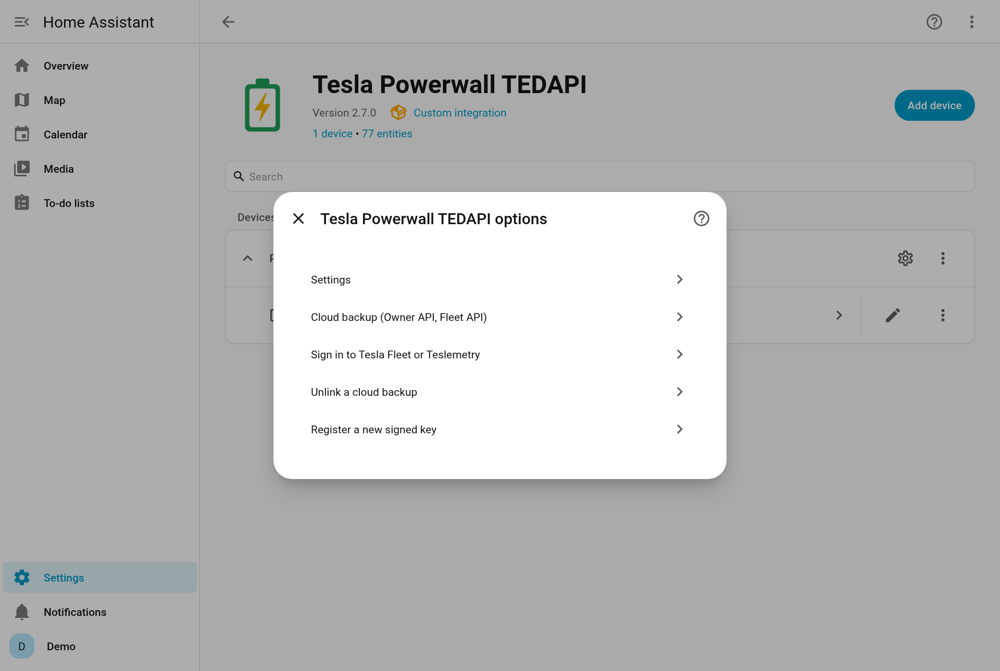
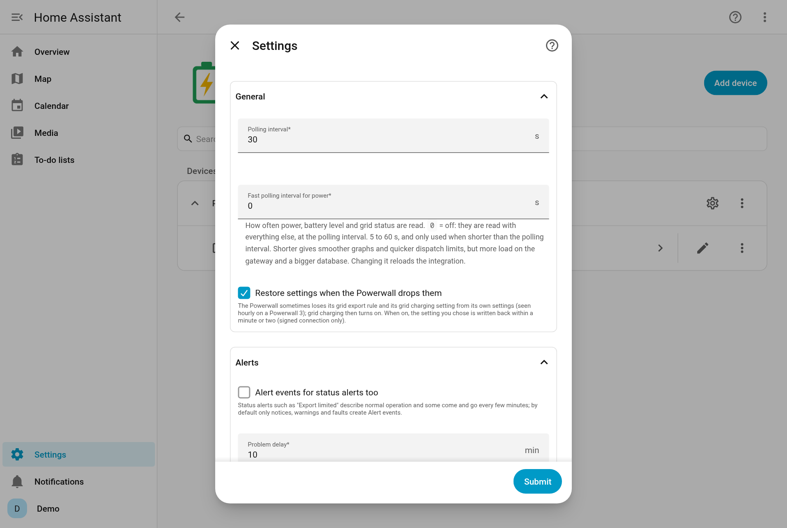

# Configuration

Everything here is done in the UI: **Settings → Devices & services → Tesla Powerwall TEDAPI**.

- [Options (Configure)](#options-configure)
- [Reconfigure](#reconfigure)
- [When the Powerwall stops accepting Home Assistant](#when-the-powerwall-stops-accepting-home-assistant)
- [Removing the integration](#removing-the-integration)

## Options (Configure)

Select **Configure** on the integration. The menu offers:

| Menu item | What it does |
|---|---|
| **Settings** | The options below. |
| **Cloud backup (Owner API, Fleet API)** | Choose which cloud backup to use, and in which order. See [Cloud backup](cloud-backup.md). |
| **Link a Tesla account (Owner API)** | Add the Owner API backup without setting the Powerwall up again (refresh token or browser sign-in). Shown when no account is linked. |
| **Sign in to Tesla Fleet or Teslemetry** | Add or renew the Fleet API backup. It continues as a reauthentication on the integration's card. |
| **Unlink a cloud backup** | Stop using one backup and keep the other. Its sign-in here is removed. |
| **Register a new signed key** | Register another key (Tesla account, Tesla Fleet or Teslemetry sign-in). Signed connections only. It continues as a reauthentication on the integration's card. |

Screenshots: options

### Settings

The form is in four sections: **General** (polling, fast polling, restore), **Alerts**, **Battery dispatch** and **Advanced** (Tesla tariff, cloud readings, diagnostics; collapsed).

| Option | Default | Range | What it does |
|---|---|---|---|
| **Polling interval** | 30 s | 10–300 s | How often the gateway is read. See [How it works](how-it-works.md#data-updates). |
| **Fast polling interval for power** | Off (0) | 0, or 5–60 s | Reads power, battery level and grid status this often, between the full reads at the polling interval. Only used when shorter than the polling interval. Smoother power graphs and quicker dispatch limits, at the cost of more load on the gateway and a bigger database. *Reloads the integration.* See [How it works](how-it-works.md#data-updates). |
| **Restore settings when the Powerwall drops them** | On | | Writes back your grid export rule and grid charging setting when the Powerwall loses them. Signed connection only. See [Dropped settings](dropped-settings.md). Turn it off if another app is meant to manage these settings. |
| **Alert events for status alerts too** | Off | | By default only notices, warnings and faults create **Alert** events. Status alerts such as *Export limited* come and go every few minutes. See [Alerts](alerts.md). |
| **Problem delay** | 10 min | 1–240 min | How long a warning or fault must last before **Problem** turns on and a repair is raised. *Backup check failed* always waits at least 30 minutes. |
| **Discharges stop at the backup reserve** | On | | A discharge dispatch started without `min_soc` stops at the backup reserve. See [Safety](safety.md). |
| **Largest dispatch power** | 10,000 W | 100–30,000 W | Dispatch calls above this power are refused. Raise it only to what your installation can safely carry: number of Powerwalls, wiring and breakers, gateway and backup switch ratings, and your grid connection and export limit. See [Safety](safety.md#battery-dispatch). Within it the Powerwall decides: one Powerwall 3 refuses more than 10,000 W. |
| **Tesla tariff (cloud)** | Off | | Adds the **Tesla tariff** sensor, the **Tariff buy price** / **Tariff sell price** sensors, the **Buy tariff** / **Sell tariff** calendars and the `get_tariff` / `set_tariff` actions. In the **Advanced** section (collapsed), and only there once a cloud backup is set up: first **Link a Tesla account** or **Sign in to Tesla Fleet or Teslemetry** from the **Configure** menu. See [Tesla tariff](tesla-tariff.md). |
| **Cloud readings while the gateway is unreachable** | Off | | While the gateway can't be reached, power and battery level come from the cloud backup instead (attribute `source: cloud`, with `last_updated` for when the cloud took the reading: up to 1–5 minutes ago). Energy counters and everything else stay *unavailable*. In the **Advanced** section, once a cloud backup is set up. |
| **Gateway configuration in diagnostics** | Off | | Adds the gateway's own configuration to diagnostics downloads, with serial numbers, location, names and credentials removed. Useful for bug reports. |

> [!NOTE]
> The settings above apply straight away, except **Tesla tariff (cloud)**. Changing that option, the cloud backup, a linked account or the connection (**Reconfigure**) reloads the integration: **a battery dispatch that is running ends** (reason `unloaded`) and the battery goes back to normal. An off-grid run continues: it's saved and picked up again.

## Reconfigure

**⋮ → Reconfigure** on the integration changes the connection without setting it up again:

| Field | |
|---|---|
| **Gateway address** | The gateway's address on your home network. You rarely need this: a new address is picked up by itself through DHCP discovery once the gateway's MAC address is known. |
| **Gateway password** | The whole QR-sticker password (upper case). Most gateways only use its last 5 characters, so those alone work too; a Backup Gateway 1 (part number `1118431-…`) needs the whole password. |
| **RSA private key file** | Full path to the key on the Home Assistant host, for example `/config/tesla_tedapi/tedapi_rsa_private.pem`. Giving a key switches a Wi-Fi password entry to signed. Leave it empty for the Wi-Fi password connection. |
| **Wi-Fi fallback address (signed only)** | Usually `192.168.91.1`, used when the home-network address stops answering, and to read follower Powerwall 3s (see [Several Powerwalls](setup.md#several-powerwalls)). Leave it empty if Home Assistant can't reach the Powerwall's Wi-Fi, or if the signed connection already uses `192.168.91.1` (followers are then read over it). |

The gateway must still be the same Powerwall (same DIN); to add a different one, add the integration again.

## When the Powerwall stops accepting Home Assistant

If the gateway keeps refusing the password (3 polls in a row) or the key (10 polls), Home Assistant shows **Reauthenticate** on the integration's card. Choose:

- **Enter the gateway password again**,
- **Register the key again** (Tesla account, Tesla Fleet or Teslemetry sign-in), or
- **Upload a different key**.

Meanwhile the settings keep working through the cloud backup, if you have one.

Common causes: the key was removed in the Tesla app, the Powerwall was reset, or a firmware update changed signed access (a separate repair says so after an update).

If the **Tesla sign-in** for the cloud backup stops working, **Settings → Repairs** offers *Sign in to Tesla again*.

## Removing the integration

1. **Settings → Devices & services → Tesla Powerwall TEDAPI → ⋮ → Delete.** This removes the entities and the integration's saved state (alert start times, the settings it restores, outage counts).
2. The key and the Tesla sign-in stay in `config/tesla_tedapi/`, because another entry may use them. If you don't set the Powerwall up again, delete that folder.
3. The key stays registered on the Powerwall. Remove it in the Tesla app if you don't want it any more.
4. If you installed through HACS: **HACS → Tesla Powerwall TEDAPI → ⋮ → Remove**, then restart Home Assistant. For a manual install, delete `config/custom_components/tesla_tedapi/` and restart.
5. Check your automations, scripts and dashboards for entities that no longer exist.
