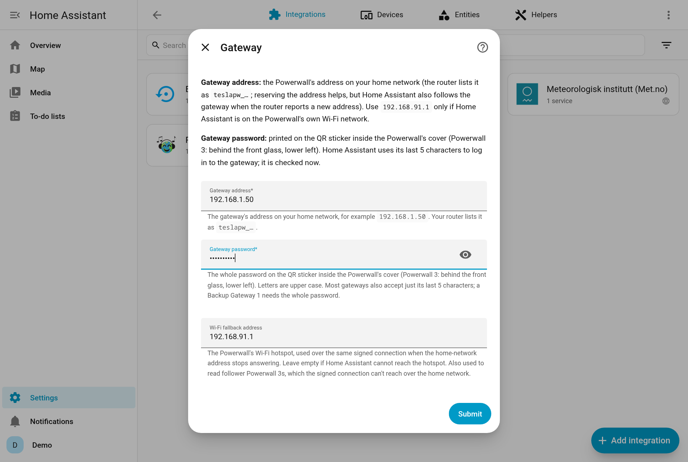
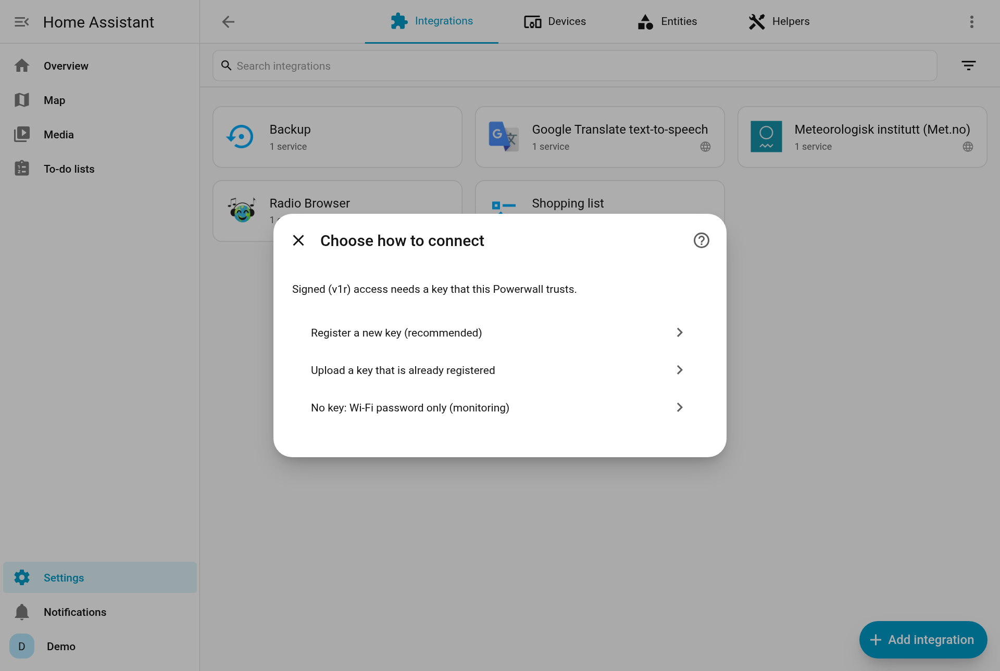
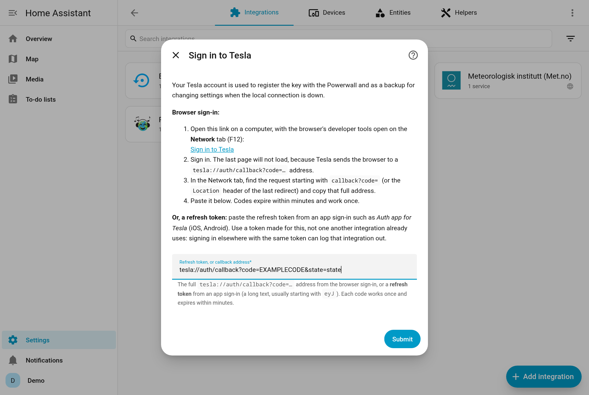
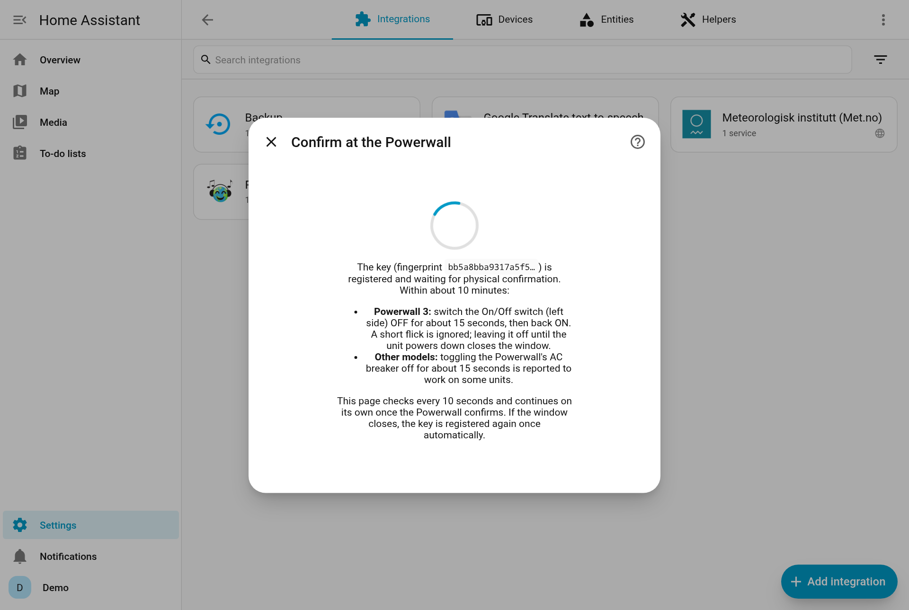
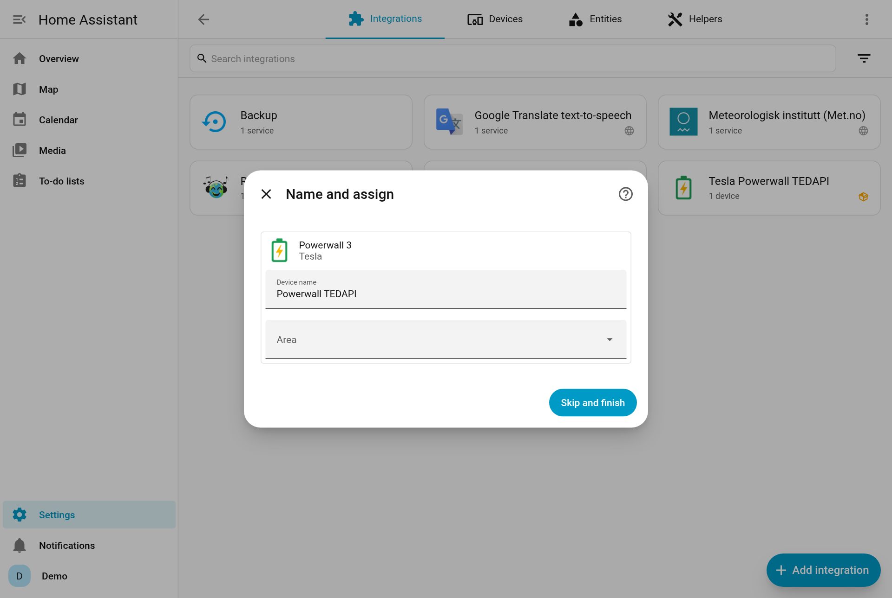

# Quick start

This is the recommended path: a **signed connection** over your home network, with the key registered through your Tesla account. It takes about 15 minutes, most of it waiting for the Powerwall.

## Before you start

You need:

- **Home Assistant 2025.11 or newer**, with [HACS](https://hacs.xyz) installed.
- **The gateway password.** It's printed on the QR sticker inside the Powerwall's cover. On a Powerwall 3 it's behind the front glass, lower left. Take a photo of it.
- **Your Tesla account** (email, password, and MFA if you use it). It's needed once, to register the key.
- **Physical access to the Powerwall** for a few minutes: you'll switch it off and on once.
- **The Powerwall on your home network** (Wi-Fi or Ethernet), so Home Assistant can reach it.

## 1. Install

1. In Home Assistant open **HACS → ⋮ → Custom repositories**.
2. Add `https://github.com/cnapagoda/ha-powerwall-tedapi` with type **Integration**.
3. Search for **Tesla Powerwall TEDAPI**, open it and select **Download**.
4. **Restart Home Assistant.**

Without HACS: download the latest release, copy `custom_components/tesla_tedapi` into your `config/custom_components/` folder, and restart.

## 2. Add the integration

Go to **Settings → Devices & services**. If Home Assistant has already found the gateway, it's listed under **Discovered**: select **Add**. Otherwise select **Add integration → Tesla Powerwall TEDAPI**.

1. **Find the gateway.** Choose **Search my network** (about 20 seconds) and pick your Powerwall, or **Enter the gateway address** yourself. Your router usually lists it as `teslapw_…`.
2. **Enter the gateway password** from the QR sticker. It's checked straight away.
3. Leave **Wi-Fi fallback address** empty unless Home Assistant can also reach the Powerwall's own Wi-Fi.

## 3. Register the key

1. Choose **Register a new key (recommended)**.

   

2. **Sign in to Tesla.** The easiest way is a **refresh token** from a token app such as *Auth app for Tesla* (iOS, macOS, Android) or *Tesla Tokens* (Android): sign in there and paste the refresh token. You can also sign in in a browser; that needs your browser's developer tools ([steps](setup.md#browser-sign-in)).

   

3. **Confirm at the Powerwall.** Once the wizard says it's waiting, within about 10 minutes:
   - **Powerwall 3:** switch the **On/Off switch** on its left side **OFF, wait about 15 seconds, then switch it back ON**. A quick flick is ignored.
   - **Other models:** switching the Powerwall's AC breaker off for about 15 seconds works on some units.

   The wizard checks every 10 seconds and moves on by itself when the Powerwall confirms the key.

   

That's it. You now have a **Powerwall TEDAPI** device with its sensors and controls.

> [!TIP]
> Have a **Teslemetry** plan or your own **Tesla Fleet** developer app? The wizard's sign-in step offers both, next to the Tesla account sign-in.

## 4. Next steps

- **[Add the Energy dashboard sensors](energy-dashboard.md).** This is the first thing most people want.
- **[Add a dashboard card](dashboards.md)** for power flows, battery level and settings.
- **Check Setup health.** The **Setup health** sensor on the device page should say *OK*. If it says *Needs attention*, its attributes name the problem.
- **Optional: set up a [cloud backup](cloud-backup.md)**, so you can still change settings if Home Assistant can't reach the gateway. If you signed in to Tesla above, it's already set up.
- **Coming from another Powerwall integration?** See [Migrating](migration.md) to keep your Energy dashboard history.
- **Want automations?** Start with the [blueprints](automations.md#blueprints). Read [Safety](safety.md) before anything that dispatches the battery.

## If something goes wrong

| Message | What to do |
|---|---|
| *The gateway refused this password* | Use the password from the QR sticker, in upper case. |
| *Could not reach the Powerwall* | Check the address; make sure Home Assistant and the Powerwall are on the same network. |
| The wizard keeps waiting at the switch step | Leave the switch **off for a full 15 seconds**. If the window closes, the wizard registers the key once more by itself; after that it asks you to try again. |
| *The Tesla Owner API refused the token (HTTP 403)* | Make sure you run 2.3.0 or newer; then sign in again. |

More in [Troubleshooting](troubleshooting.md).
