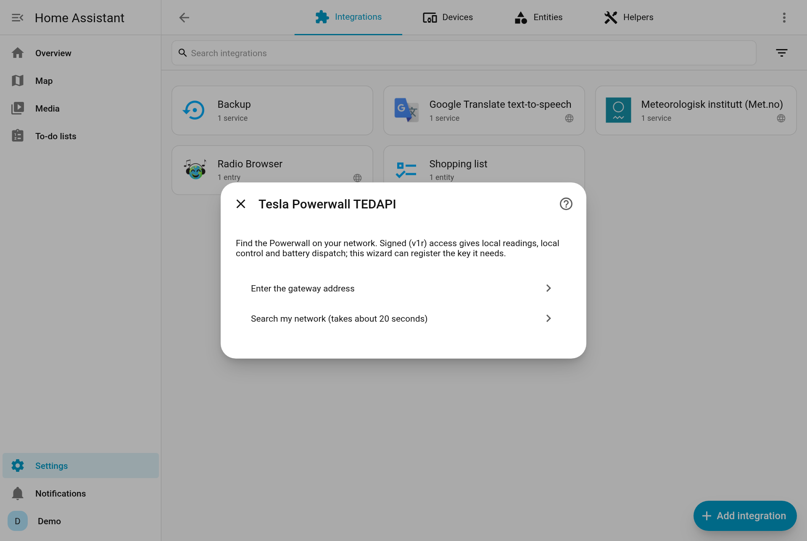
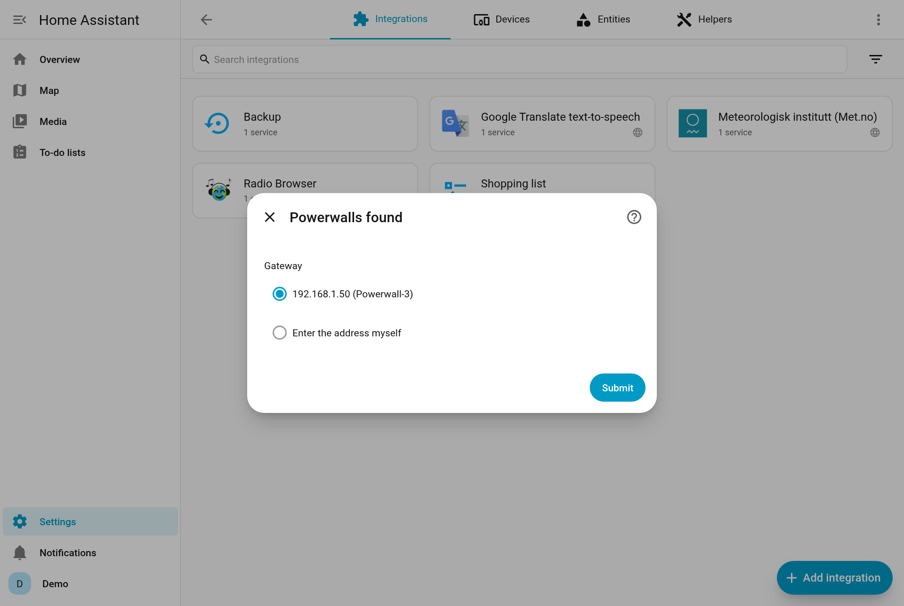
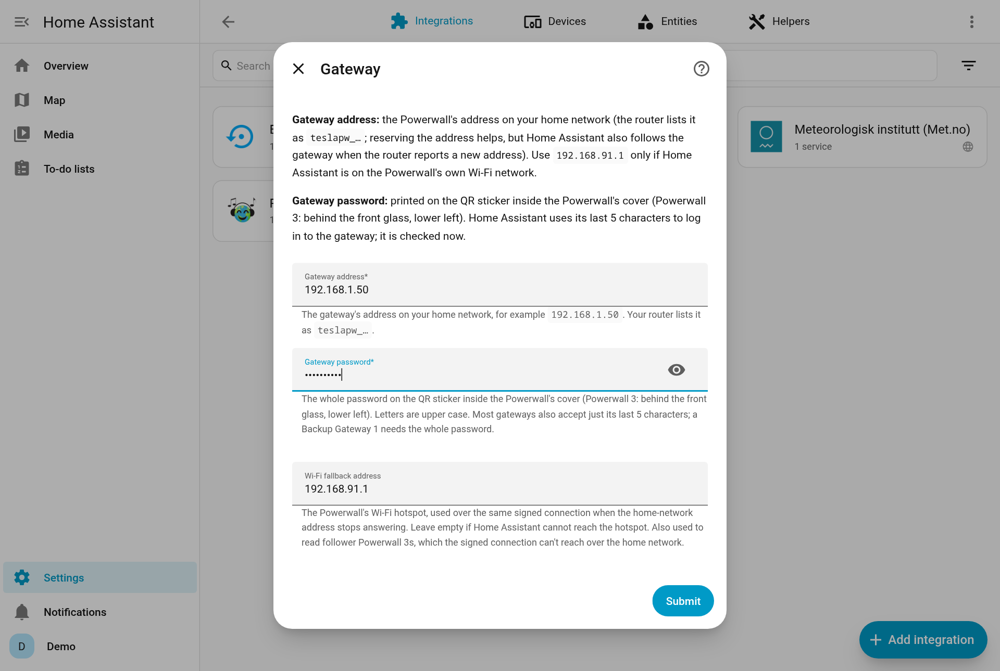
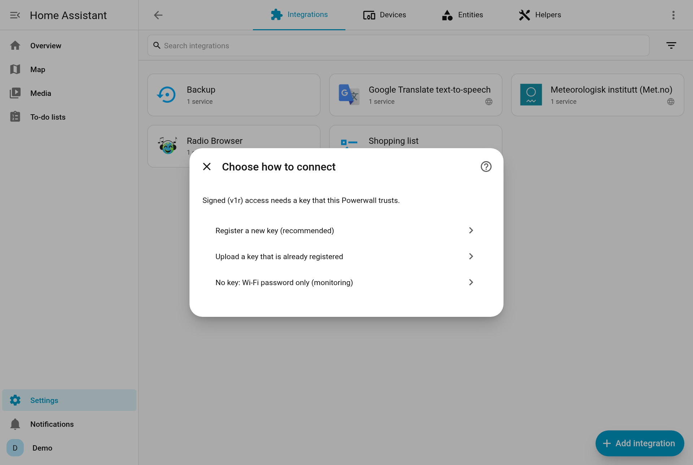
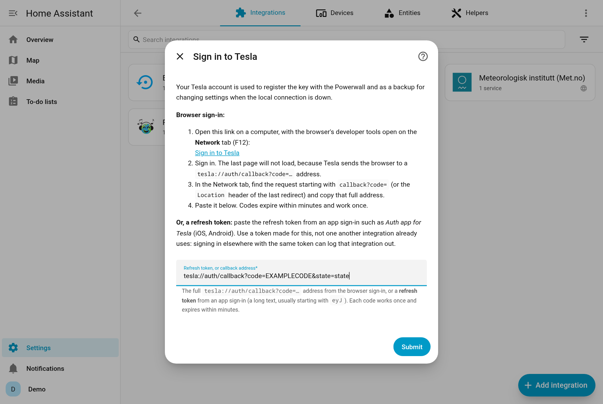
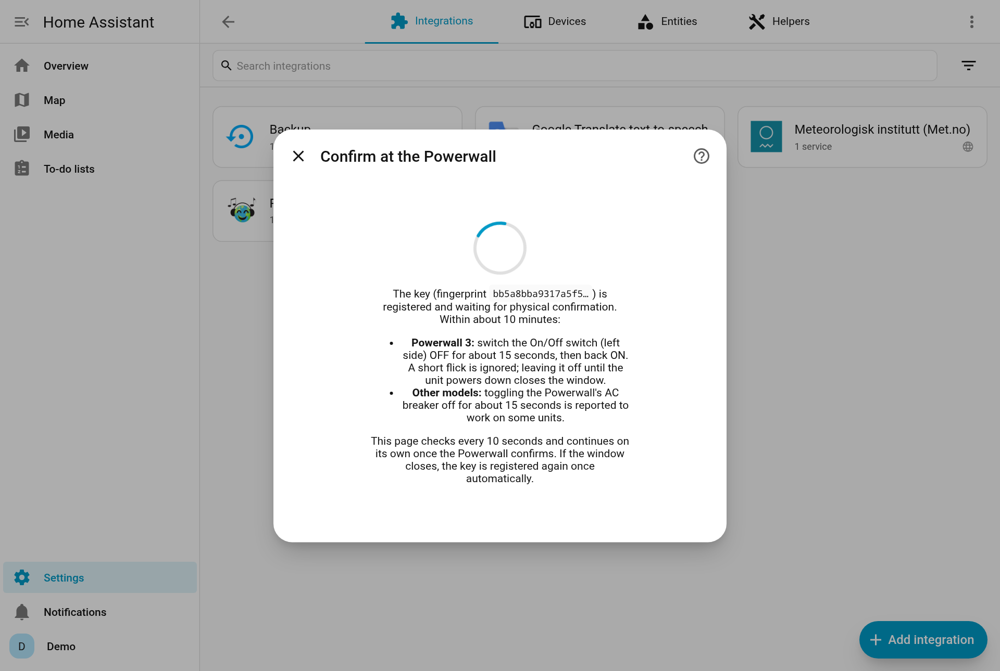
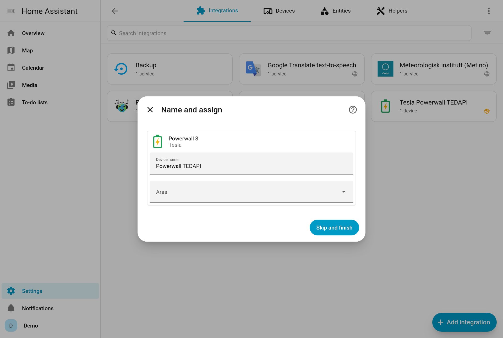
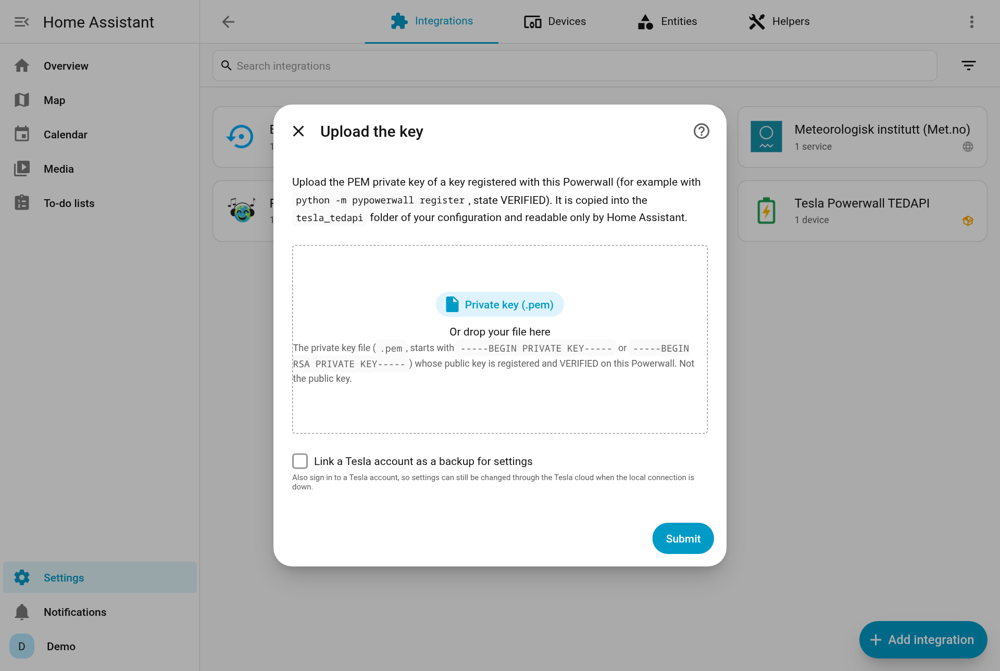
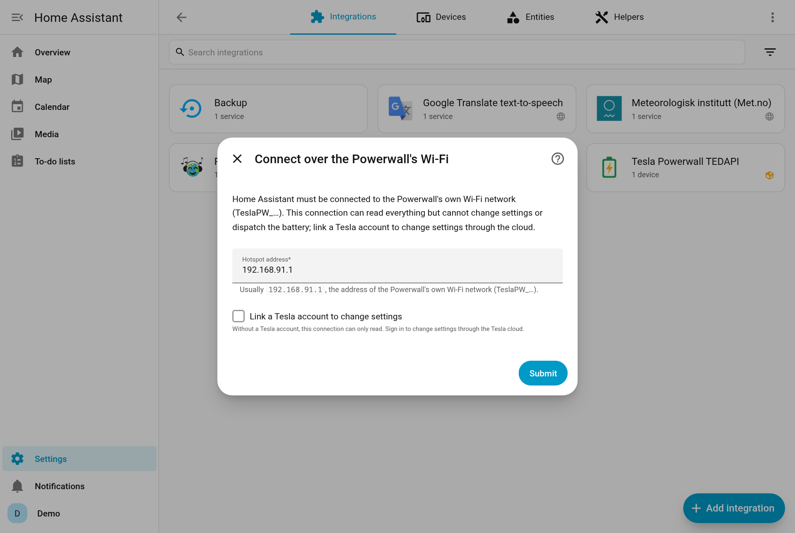

# Setup in detail

The [Quick start](quick-start.md) covers the recommended path. This page covers every option.

_Screenshots come from a test Home Assistant with example data (no real Powerwall or account)._

- [Installation](#installation)
- [1. Find the gateway](#1-find-the-gateway)
- [2. Choose how to connect](#2-choose-how-to-connect)
  - [Register a new key (recommended)](#a-register-a-new-key-recommended)
  - [Tesla Fleet: your own developer app](#tesla-fleet-your-own-developer-app)
  - [Upload a key that is already registered](#b-upload-a-key-that-is-already-registered)
  - [Wi-Fi password only](#c-wi-fi-password-only)
- [Signing in to Tesla](#signing-in-to-tesla)
- [Registering with the Fleet API (developers)](#registering-with-the-fleet-api-developers)
- [Several Powerwalls](#several-powerwalls)

## Installation

### HACS (recommended)

1. In Home Assistant open **HACS**, search for **Tesla Powerwall TEDAPI**, open it and select **Download**.
2. **Restart Home Assistant.**

[](https://my.home-assistant.io/redirect/hacs_repository/?owner=cnapagoda&repository=ha-powerwall-tedapi&category=integration)

Not found in the search? Add it as a custom repository first: **HACS → ⋮ → Custom repositories**, add `https://github.com/cnapagoda/ha-powerwall-tedapi` with type **Integration**, then search again.

HACS tells you about new versions. Read the [CHANGELOG](../CHANGELOG.md) before you update.

### Manual

1. Download the latest [release](https://github.com/cnapagoda/ha-powerwall-tedapi/releases) and copy `custom_components/tesla_tedapi` into your Home Assistant `config/custom_components/` folder.
2. Restart Home Assistant.

## 1. Find the gateway

Go to **Settings → Devices & services → Add integration → Tesla Powerwall TEDAPI**. If Home Assistant has already spotted the gateway on your network, it's listed under **Discovered**; select **Add** there instead.

- **Search my network** scans your network for Tesla gateways (about 20 seconds) and lists what it finds, or
- **Enter the gateway address** yourself. Your router lists the gateway as `teslapw_…`.

Then enter the **gateway password**. You need it for every way of connecting: it's printed on the QR sticker inside the Powerwall's cover (Powerwall 3: behind the front glass, lower left). Home Assistant logs in to the gateway with its last 5 characters. It is checked straight away, so a wrong password or address is reported here, not after the Tesla sign-in.

**Wi-Fi fallback address** (optional, signed connection only): `192.168.91.1` if Home Assistant can also reach the Powerwall's own Wi-Fi network. Readings then switch to it when the home-network address stops answering. Leave it empty otherwise.

<details>
<summary>Screenshots: finding the gateway</summary>







</details>

**You don't need to reserve the gateway's IP address.** When your router gives it a new address, Home Assistant notices the gateway (DHCP discovery), checks it's the same Powerwall, and updates the address.

## 2. Choose how to connect



| | Signed (paths A and B) | Wi-Fi password (path C) |
|---|---|---|
| Readings | ✅ local | ✅ local |
| Change mode, reserve, grid charging, export | ✅ local (cloud backup if set up) | ☁️ only through a [cloud backup](cloud-backup.md) |
| Battery dispatch, max backup, go off-grid | ✅ | ❌ |
| Reaches the Powerwall at | Home-network address, or its Wi-Fi | Its Wi-Fi only (Home Assistant must join `TeslaPW_…`) |

**Signed is recommended.** It works over your normal home network, so you don't need a second Wi-Fi adapter on the Home Assistant host.

### Why a Tesla account to register a key?

A new key is registered by one command sent through Tesla's cloud; the Powerwall then waits for you to confirm it at the unit. The Powerwall does accept a key sent over its own Wi-Fi with just the gateway password, but in a test (Powerwall 3, firmware 26.34.1) a key added that way never verified. Keys only verify when they are registered through Tesla's cloud.

After the key is verified, **local control never uses the Tesla account**. Nothing is exposed to the internet. The account is then only used as the optional [cloud backup](cloud-backup.md).

Either Tesla API can send the registration:

| | Owner API | Fleet API |
|---|---|---|
| Who it's for | Everyone | People with a Teslemetry plan or their own Tesla developer app |
| You need | A Tesla sign-in: a refresh token from a token app, or a browser sign-in | A Teslemetry access token, **or** a Tesla developer app |
| Where | Path **A** in this wizard | Path **A** in this wizard (choose Tesla Fleet or Teslemetry), or `python -m pypowerwall register` on a computer followed by path **B** |

### A. Register a new key (recommended)

1. **Sign in**, one of:
   - **Tesla account (Owner API):** a refresh token or a browser sign-in ([how](#signing-in-to-tesla)).
   - **Tesla Fleet:** your own developer app ([below](#tesla-fleet-your-own-developer-app)).
   - **Teslemetry:** an access token from the [Teslemetry console](https://teslemetry.com/console), with the energy permissions. It's used as it is and never refreshed here: if Teslemetry stops accepting it (for example you revoke it), sign in again with a new one (**Configure → Sign in to Tesla Fleet or Teslemetry**). The sign-in uses your account's Teslemetry region.
2. **The energy site** with this gateway is picked automatically. You only choose when the wizard can't tell.
3. **Confirm at the Powerwall.** The wizard creates an RSA-4096 key in `config/tesla_tedapi/` and registers it with your Powerwall. Within about **10 minutes**:
   - **Powerwall 3:** switch the **On/Off switch** (left side) **OFF for about 15 seconds, then back ON**. A quick flick is ignored. Don't leave it off until the unit powers down.
   - **Other models:** switching the Powerwall's AC breaker off for about 15 seconds is reported to work on some units.

   The wizard checks every 10 seconds and continues by itself once the Powerwall confirms. It shows the start of the key's fingerprint so you can tell keys apart. If the 10-minute window closes, it registers the key again once by itself; after that it asks you to try again.

The sign-in is kept (a Tesla account in `config/tesla_tedapi/.pypowerwall.auth`, a Fleet API sign-in in the integration's entry) and used as the [cloud backup](cloud-backup.md).

<details>
<summary>Screenshots: Tesla sign-in, confirmation, done</summary>







</details>

### Tesla Fleet: your own developer app

Tesla Fleet signs in with your own Tesla developer app. The app you use for Home Assistant's [Tesla Fleet](https://www.home-assistant.io/integrations/tesla_fleet) integration works too; the two sign-ins are separate. If the app isn't added yet, Home Assistant opens its **Add application credentials** dialog for the app's **Client ID** and **Client Secret** (kept under **Settings → Application credentials**). Then Tesla's sign-in page opens: allow the energy permissions. If a blank page is left behind after the sign-in, close it: your original tab shows the result.

The app needs the energy scopes, `https://my.home-assistant.io/redirect/oauth` as a redirect URI, and a registered domain. Making one is described [below](#registering-with-the-fleet-api-developers).

On an existing setup, use **Configure → Register a new signed key**, or **Configure → Sign in to Tesla Fleet or Teslemetry** for the cloud backup only.

### B. Upload a key that is already registered

If you registered a key with `python -m pypowerwall register`, upload its `tedapi_rsa_private.pem`. It is checked (it must be an RSA private key) and copied into `config/tesla_tedapi/` with owner-only permissions. You can also link a Tesla account here for the cloud backup.

<details>
<summary>Screenshot: key upload</summary>



</details>

### C. Wi-Fi password only

Home Assistant must be connected to the Powerwall's `TeslaPW_…` Wi-Fi network (address `192.168.91.1`), usually through a second Wi-Fi adapter. The gateway refuses the password on its home-network address, so this only works over its Wi-Fi. A signed connection (paths A and B) works on the home network. You get local readings. To change settings, link a Tesla account (or use Tesla Fleet / Teslemetry) as a [cloud backup](cloud-backup.md). Battery dispatch, max backup and going off-grid aren't available.

You can switch to signed later: **⋮ → Reconfigure** and give a key file.

<details>
<summary>Screenshot: Wi-Fi only</summary>



</details>

## Signing in to Tesla

The **Sign in to Tesla** step takes either a **refresh token** or a **callback address** from a browser sign-in. The same step is used in setup, in **Configure → Link a Tesla account**, and in the *Sign in to Tesla again* repair.

### Refresh token (easiest)

No developer tools needed, and it can be pasted from a phone. Like the [Tesla Custom](https://github.com/alandtse/tesla) integration, this integration takes a **refresh token** from an app that runs Tesla's own sign-in page:

| App | Platforms |
|---|---|
| **Auth app for Tesla** | iOS, macOS (App Store) and Android |
| **Tesla Tokens** | Android (Google Play) |
| [**tesla_auth**](https://github.com/adriankumpf/tesla_auth) | Windows, macOS, Linux (command line, opens a sign-in window) |

1. Open the app and sign in to Tesla with your email, password and MFA. The sign-in happens on Tesla's page; the app only receives the tokens.
2. The app shows an **access token** and a **refresh token**. Copy the **refresh token**: a long string, usually starting with `eyJ`. The access token expires after 8 hours, so it won't do.
3. Paste it into the **Sign in to Tesla** step.

The integration swaps the token for a fresh pair straight away and keeps refreshing it.

> [!IMPORTANT]
> - **Make a new token for this integration.** Each refresh replaces the token. If two integrations share one, the one that refreshes second is signed out. Don't reuse the token from Tesla Custom, Tesla Fleet or another app.
> - **Treat it like a password.** A refresh token gives full access to your Tesla account until you change your password. Only get it from an app you trust; changing your Tesla password revokes it.

### Browser sign-in

The wizard shows a sign-in link. Tesla's sign-in ends by sending the browser to a `tesla://auth/callback?code=…` address that browsers can't open, so you copy it by hand:

1. On a computer, open the browser's developer tools (F12) on the **Network** tab.
2. Open the link and sign in, including MFA. Tesla always shows its full sign-in form.
3. In the Network list, find the request that starts with `callback?code=`, or the last redirect's `Location` header. Copy the full address.
4. Paste it into the wizard.

Codes expire within minutes and work only once. If Tesla rejects a code, the wizard shows a new link: sign in with that one and copy the address straight away. A paste that isn't from the current link leaves the link unchanged, so a sign-in tab you still have open keeps working.

## Registering with the Fleet API (developers)

You only need this for your **own** Tesla developer app: for the [Tesla Fleet sign-in](#tesla-fleet-your-own-developer-app), or to register a key with `pypowerwall register`. The Fleet API needs a developer app whose public key is hosted on a domain you own. If you already use Home Assistant's [Tesla Fleet](https://www.home-assistant.io/integrations/tesla_fleet) integration, you have both and can reuse the same developer app.

1. **Developer app.** At [developer.tesla.com/request](https://developer.tesla.com/request), create an app with:
   - OAuth grant type: *Authorization Code and Machine-to-Machine*.
   - Allowed origin: your domain, for example `https://yourdomain.com/`.
   - Allowed redirect URIs: `https://my.home-assistant.io/redirect/oauth` (for the Tesla Fleet sign-in), and one for `pypowerwall register`, for example `https://yourdomain.com/callback`. That page doesn't need to exist; you only copy its address.
   - Scopes: **Energy Product Information** and **Energy Product Settings**. The energy APIs are free; no billing is needed.

   Note the **Client ID** and **Client Secret** under *View Details → Credentials & APIs*.
2. **Host the public key** at `https://yourdomain.com/.well-known/appspecific/com.tesla.3p.public-key.pem`, with a valid certificate. Options listed in the Tesla Fleet documentation:
   - The [NGINX Home Assistant SSL proxy](https://github.com/home-assistant/addons/blob/master/nginx_proxy/DOCS.md) app, with a custom `location` for the `.well-known` path.
   - A hosting service such as [FleetKey.net](https://fleetkey.net) or [MyTeslamate](https://app.myteslamate.com/fleet).

   Tesla may silently reject some domains (for example `ddns.net` hostnames). China isn't supported. Tesla only answers an app whose domain is registered with it (the partner registration). Home Assistant's Tesla Fleet integration does this in its setup; this integration doesn't. Without it, see [Tesla's Fleet API guide](https://developer.tesla.com/docs/fleet-api/getting-started/what-is-fleet-api).
3. **Register the Powerwall key** on a computer with Python:

   ```bash
   pip install pypowerwall
   export TESLA_CLIENT_ID="your-client-id"
   export TESLA_CLIENT_SECRET="your-client-secret"
   export TESLA_REDIRECT_URI="https://yourdomain.com/callback"
   # optional, otherwise it asks: NA, EU or CN region
   export TESLA_FLEET_API_BASE="https://fleet-api.prd.na.vn.cloud.tesla.com"
   python -m pypowerwall register      # choose [2] Fleet API
   ```

   Sign in, allow the energy scopes, then paste the address the browser ends on. This sign-in is separate from the Tesla Fleet integration's, so it doesn't sign that integration out.
4. **Confirm at the Powerwall** within about 10 minutes, as in path A. The command waits until the key is `VERIFIED`.
5. **Upload** the `tedapi_rsa_private.pem` it wrote, with path B. This is the Powerwall key, not the Fleet app's key.

## Several Powerwalls

Add the integration once per **gateway**. Expansion packs and the batteries behind one gateway belong to that gateway's entry and show up by themselves.

- The second entry's entity IDs end in `_2` (both devices are called *Powerwall TEDAPI*). Rename the device to tell them apart.
- Actions need `config_entry_id` when more than one Powerwall is set up. In the action editor, pick the Powerwall from the list.
- Each entry keeps its own energy site for the cloud backup, so several Powerwalls on one Tesla account work.

## Next steps

- [Configuration](configuration.md): polling interval, alert options, dispatch limits, cloud backup.
- [Energy dashboard](energy-dashboard.md).
- [Dashboards](dashboards.md).
